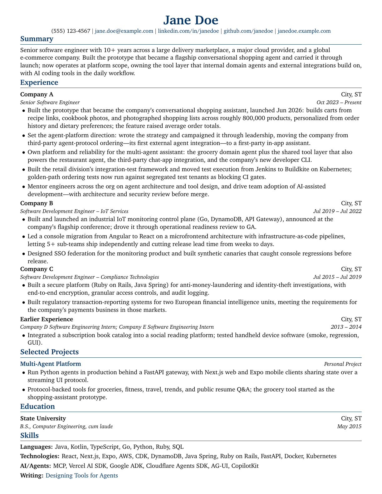

# LaTeX Resume Template

[](LICENSE)

`resume-template` renders [JSON Resume](https://jsonresume.org/schema) data into
ATS-readable LaTeX and PDF, locally or through a reusable GitHub Actions workflow.

<p align="center">
  
</p>

[`resume.json`](resume.json) contains intentionally generic placeholder data;
[`resume.pdf`](resume.pdf) is the checked-in result of rendering it.

Two templates in [`templates/`](templates):

- `resume` (default): one page, 10pt Charter. Work, projects, education, skills.
- `cv`: multi-page, 12pt Latin Modern with contact icons. Education, work, research,
  publications, volunteer, leadership, awards, skills, certificates, languages and
  interests, each skipped when empty. Section titles can be renamed with `meta.titles`;
  the comment at the top of [`cv.tex`](templates/cv.tex) lists its custom fields.

## Use it from your own repo

Commit your `resume.json` and add a workflow that calls this repo's reusable
workflow. It builds the PDF on GitHub Actions (no local TeX needed) and uploads
`<output>.tex`/`<output>.pdf` as the `resume` artifact on every run. Download them
from the workflow run and include any checked-in updates in a pull request.

```yaml
# .github/workflows/pdf.yml
name: PDF
on:
  push:
    branches: [main]
    paths: [resume.json]
  pull_request:
    paths: [resume.json]
  workflow_dispatch:
jobs:
  pdf:
    uses: aranlucas/resume-template/.github/workflows/build-resume.yml@main
    permissions:
      contents: read
    with:
      output: Jane_Doe_Resume # default: resume
      template: cv # default: resume
```

Dates must be `YYYY` or `YYYY-MM`; day-level dates are rejected. In the resume
layout, completed jobs with both dates and a position ending in the word "Intern"
are merged into "Earlier Experience". Ongoing internships stay separate with
"Present"; missing dates are omitted and highlights may be absent or empty.
Publications render as a one-line "Writing" row.

## Build locally

Use the Node.js version in [`.node-version`](.node-version) and pnpm from
[`package.json`](package.json). Install a TeX distribution such as
[MacTeX](https://www.tug.org/mactex/) or [TeX Live](https://www.tug.org/texlive/) so `pdflatex` is on your `PATH`, then:

```bash
pnpm install
pnpm pdf        # resume.json → resume.tex → resume.pdf
```

From another repo, add this package as a dependency (for example
`"resume-template": "link:../resume-template"`) and run
`pnpm exec resume-template <resume.json> [output name] [--template cv]`. The package also exports
`loadResume`, `assertJsonResume`, `createRenderer`, `renderResumeDocument`, and
`buildPdf`. Use `renderResumeDocument(data, { template: "resume", searchPaths: [] })`
to validate JSON Resume data and supported dates and return TeX without writing files.
`buildPdf(data, output, options)` uses the same validation and rendering operation.
Use `createRenderer(searchPaths)` for custom Nunjucks/Markdown templates with the same
filters; it remains generic and does not impose JSON Resume validation.

### Customize one section

Each layout includes section partials from `templates/resume/sections/` or
`templates/cv/sections/`. The main `.tex` file owns the preamble, layout macros,
and section order. Each partial owns its heading, entries, and empty-section
check. For example, the resume's `experience.tex` also owns internship grouping.

To customize a section, copy its partial into a directory with the same relative
path, then pass that directory as a search path. For example, put a replacement
summary in `my-templates/resume/sections/summary.tex`:

```tex
<% if basics.summary %>
\section{Profile}
<< basics.summary | tex >>
<% endif %>
```

Render the built-in layout with that override:

```js
import { resolve } from "node:path";
import { buildPdf, loadResume } from "resume-template";

buildPdf(loadResume("resume.json"), "resume", {
  template: "resume",
  searchPaths: [resolve("my-templates")],
});
```

Search paths are checked in order before the bundled templates, so sections you
do not override use their defaults. The same option works with
`renderResumeDocument`. The CLI uses the bundled templates.

Partials inherit the document's data and Nunjucks context. CV partials can also
call `section(key, fallback)` (honors `meta.titles`) and
`entry(heading, location, subheading, dates, highlights)` (escapes its arguments
and omits empty bullet lists). Escape values you render directly with `tex`, or
`url` inside a link target. Use `include` for partials so these macros retain the
parent context.

For a complete layout variant, copy `templates/resume.tex` or `templates/cv.tex`
into your search directory, keep the includes you need, and reorder or remove
them there. You can bundle that layout and its overrides in one directory. A
missing partial fails rendering so a misspelled section path cannot silently
drop content.

PDF builds use a temporary output directory with shell escape disabled and a two-minute
compiler timeout. A failed build leaves existing `.tex`/`.pdf` outputs unchanged and
copies the compiler log to `<output>.log` when available. Relative LaTeX inputs are
still resolved from the output directory. Only the final `.tex`, `.pdf`, and diagnostic
`.log` are retained.

## Verification

```bash
pnpm test       # Vitest renderer, custom templates, CLI and controlled compiler regressions
pnpm test:pdf   # real TeX/PDF and ATS text checks; requires TeX Live and Poppler
```

The real-PDF checks use synthetic data and the public placeholder sample. The `cv`
layout additionally requires Latin Modern and the `fontawesome` LaTeX package
(typically `lmodern` and `texlive-fonts-extra` on Debian/Ubuntu). Check your TeX
installation before running `test:pdf`.

CI also runs `pnpm test:e2e` with the pinned `e2e` runner's engine-less CLI target.
It invokes the public CLI, extracts real PDF contact text, and checks that invalid
input leaves the previous output intact. No model credentials are required.
See [the reliability audit](docs/reliability-audit.md) for findings and scope.
